# Entity relationship diagrams

Generated from `docs/generator/spec_schema.py`. One diagram per area. Tables from another area that are referenced here appear as stubs (key only).

Every tenant-owned table also has `TenantId -> Tenants.Id`, left out of the drawings. Relationships labelled `(tenant-scoped)` are composite foreign keys `(TenantId, X)`, so the database rejects a reference to a row of another tenant. References to users go to `UserTenantMemberships` (a user is a member of a tenant), not directly to the global `AspNetUsers`.

Legend: `||--o{` one to many (required), `|o--o{` one to many (optional FK). Column lists show keys and unique columns only; see DATA_DICTIONARY.md for all columns.

## Tenancy

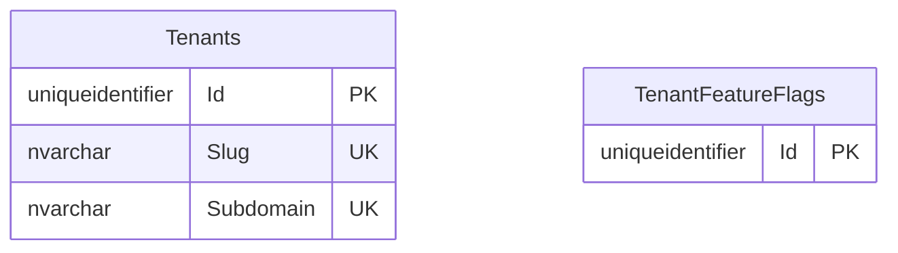

- **Tenants**: One row per white-label customer. Not itself tenant-filtered.
- **TenantFeatureFlags**: Tenant-level feature toggles such as wallet, affiliates, live_classes, ai_tutor.

## Identity & Auth

```mermaid
erDiagram
    AspNetUsers {
        uniqueidentifier Id PK
    }
    AspNetRoles {
        uniqueidentifier Id PK
        nvarchar NormalizedName UK
    }
    AspNetUserRoles {
        uniqueidentifier UserId FK
        uniqueidentifier RoleId FK
    }
    AspNetRoleClaims {
        int Id PK
        uniqueidentifier RoleId FK
    }
    AspNetUserTokens {
        uniqueidentifier UserId FK
    }
    AspNetUserClaims {
        int Id PK
        uniqueidentifier UserId FK
    }
    AspNetUserLogins {
        uniqueidentifier UserId FK
    }
    UserTenantMemberships {
        uniqueidentifier Id PK
        uniqueidentifier UserId FK
        uniqueidentifier GrantedBy FK
    }
    RefreshTokens {
        uniqueidentifier Id PK
        uniqueidentifier UserId FK
        uniqueidentifier DeviceId FK
        nvarchar TokenHash UK
    }
    OtpCodes {
        uniqueidentifier Id PK
        uniqueidentifier UserId FK
    }
    UserDevices {
        uniqueidentifier Id PK
    }
    AspNetRoles ||--o{ AspNetRoleClaims : "RoleId"
    AspNetRoles ||--o{ AspNetUserRoles : "RoleId"
    AspNetUsers |o--o{ OtpCodes : "UserId"
    AspNetUsers |o--o{ UserTenantMemberships : "GrantedBy"
    AspNetUsers ||--o{ AspNetUserClaims : "UserId"
    AspNetUsers ||--o{ AspNetUserLogins : "UserId"
    AspNetUsers ||--o{ AspNetUserRoles : "UserId"
    AspNetUsers ||--o{ AspNetUserTokens : "UserId"
    AspNetUsers ||--o{ RefreshTokens : "UserId"
    AspNetUsers ||--o{ UserTenantMemberships : "UserId"
    UserDevices |o--o{ RefreshTokens : "DeviceId"
```

- **AspNetUsers**: ASP.NET Core Identity user (Guid key). TenantId is NULL only for SuperAdmin. UserName is stored as '<tenantSlug>:<email>' so the same email can exist in two tenants.
- **AspNetRoles**: Global roles: SuperAdmin, TenantAdmin, Instructor, TeachingAssistant, Student, Parent.
- **AspNetUserTokens**: ASP.NET Core Identity token store (authenticator keys, recovery codes). Composite primary key.
- **AspNetUserLogins**: Social login hooks (Google, Facebook, Apple). One row per user per external identity: the same provider account MAY be linked to per-tenant accounts of the same person in different academies, so uniqueness is per (provider, key, user), not global.
- **UserTenantMemberships**: Tenant membership of a global identity. EVERY user-to-tenant-data reference points here as (TenantId, UserId), so a row can only reference a user who is a member of the same tenant. Each tenant user has one Home row; a SuperAdmin acts inside a tenant only through an explicit, audited SupportAccess row.
- **RefreshTokens**: Rotating refresh tokens. Only the SHA-256 hash is stored. Reuse of a revoked token revokes the whole chain.
- **OtpCodes**: Short-lived OTPs. Hash only; max attempts enforced in code.

## Anti-Piracy

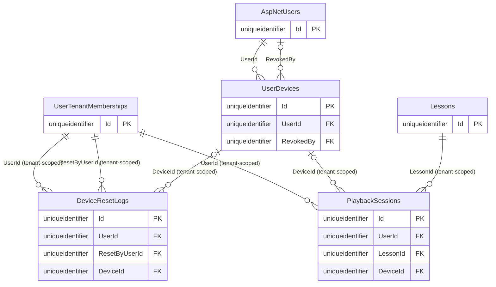

- **UserDevices**: Device binding. Active devices per user and DeviceType are capped by Tenants.MaxMobileDevices / MaxWebDevices.
- **DeviceResetLogs**: Who reset which student's devices and when (also written to AuditLogs).
- **PlaybackSessions**: Heartbeat log used to detect concurrent playback of one account on many devices. Detection signal, not a block by itself.

## Files & Jobs

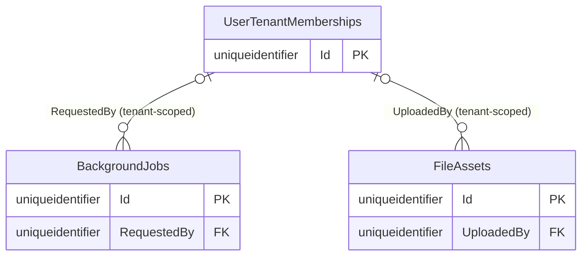

- **FileAssets**: Metadata for every stored file. Bytes live on disk or object storage, never in SQL.
- **BackgroundJobs**: Application-level job status mirrored to clients over SignalR. Hangfire keeps its own [HangFire] schema.

## Course Catalog

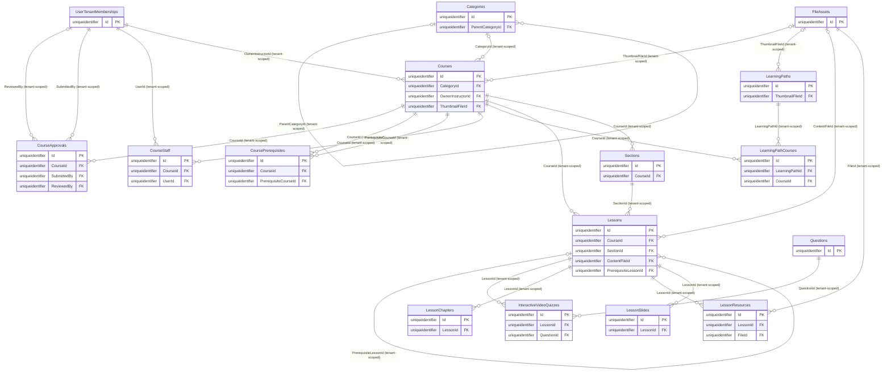

- **CourseApprovals**: Instructor course approval workflow history.
- **Lessons**: Video files are stored as FileAssets; streaming and DRM strategy is a Phase 3 decision (see docs/SECURITY_LIMITS.md).
- **LessonSlides**: Interactive slide deck content.
- **InteractiveVideoQuizzes**: Pauses the player at TimestampSeconds until the question is answered.
- **LearningPathCourses**: Mandatory sequential ordering is enforced in the application layer.

## Learning Progress

```mermaid
erDiagram
    Enrollments {
        uniqueidentifier Id PK
        uniqueidentifier UserId FK
        uniqueidentifier CourseId FK
        uniqueidentifier OrderItemId FK
    }
    LearningPathEnrollments {
        uniqueidentifier Id PK
        uniqueidentifier UserId FK
        uniqueidentifier LearningPathId FK
    }
    LessonAccessGrants {
        uniqueidentifier Id PK
        uniqueidentifier UserId FK
        uniqueidentifier LessonId FK
        uniqueidentifier OrderItemId FK
    }
    LessonProgress {
        uniqueidentifier Id PK
        uniqueidentifier UserId FK
        uniqueidentifier LessonId FK
        uniqueidentifier CourseId FK
    }
    LessonNotes {
        uniqueidentifier Id PK
        uniqueidentifier UserId FK
        uniqueidentifier LessonId FK
    }
    LessonBookmarks {
        uniqueidentifier Id PK
        uniqueidentifier UserId FK
        uniqueidentifier LessonId FK
    }
    InteractiveQuizResponses {
        uniqueidentifier Id PK
        uniqueidentifier UserId FK
        uniqueidentifier InteractiveVideoQuizId FK
    }
    StudySessions {
        uniqueidentifier Id PK
        uniqueidentifier UserId FK
        uniqueidentifier CourseId FK
        uniqueidentifier LessonId FK
    }
    Courses {
        uniqueidentifier Id PK
    }
    InteractiveVideoQuizzes {
        uniqueidentifier Id PK
    }
    LearningPaths {
        uniqueidentifier Id PK
    }
    Lessons {
        uniqueidentifier Id PK
    }
    OrderItems {
        uniqueidentifier Id PK
    }
    UserTenantMemberships {
        uniqueidentifier Id PK
    }
    Courses |o--o{ StudySessions : "CourseId (tenant-scoped)"
    Courses ||--o{ Enrollments : "CourseId (tenant-scoped)"
    Courses ||--o{ LessonProgress : "CourseId (tenant-scoped)"
    InteractiveVideoQuizzes ||--o{ InteractiveQuizResponses : "InteractiveVideoQuizId (tenant-scoped)"
    LearningPaths ||--o{ LearningPathEnrollments : "LearningPathId (tenant-scoped)"
    Lessons |o--o{ StudySessions : "LessonId (tenant-scoped)"
    Lessons ||--o{ LessonAccessGrants : "LessonId (tenant-scoped)"
    Lessons ||--o{ LessonBookmarks : "LessonId (tenant-scoped)"
    Lessons ||--o{ LessonNotes : "LessonId (tenant-scoped)"
    Lessons ||--o{ LessonProgress : "LessonId (tenant-scoped)"
    OrderItems |o--o{ Enrollments : "OrderItemId (tenant-scoped)"
    OrderItems |o--o{ LessonAccessGrants : "OrderItemId (tenant-scoped)"
    UserTenantMemberships ||--o{ Enrollments : "UserId (tenant-scoped)"
    UserTenantMemberships ||--o{ InteractiveQuizResponses : "UserId (tenant-scoped)"
    UserTenantMemberships ||--o{ LearningPathEnrollments : "UserId (tenant-scoped)"
    UserTenantMemberships ||--o{ LessonAccessGrants : "UserId (tenant-scoped)"
    UserTenantMemberships ||--o{ LessonBookmarks : "UserId (tenant-scoped)"
    UserTenantMemberships ||--o{ LessonNotes : "UserId (tenant-scoped)"
    UserTenantMemberships ||--o{ LessonProgress : "UserId (tenant-scoped)"
    UserTenantMemberships ||--o{ StudySessions : "UserId (tenant-scoped)"
```

- **LessonAccessGrants**: Pay-per-lesson unlocks without a course enrollment.
- **StudySessions**: Feeds weekly study hours (parent portal), streaks and risk scoring.

## Assessments

```mermaid
erDiagram
    QuestionBanks {
        uniqueidentifier Id PK
        uniqueidentifier CourseId FK
    }
    Questions {
        uniqueidentifier Id PK
        uniqueidentifier QuestionBankId FK
    }
    QuestionOptions {
        uniqueidentifier Id PK
        uniqueidentifier QuestionId FK
    }
    Exams {
        uniqueidentifier Id PK
        uniqueidentifier CourseId FK
        uniqueidentifier SectionId FK
    }
    ExamQuestionRules {
        uniqueidentifier Id PK
        uniqueidentifier ExamId FK
        uniqueidentifier QuestionId FK
        uniqueidentifier QuestionBankId FK
    }
    ExamAttempts {
        uniqueidentifier Id PK
        uniqueidentifier ExamId FK
        uniqueidentifier UserId FK
        uniqueidentifier DeviceId FK
    }
    ExamAttemptQuestions {
        uniqueidentifier Id PK
        uniqueidentifier ExamAttemptId FK
        uniqueidentifier QuestionId FK
    }
    ExamAnswers {
        uniqueidentifier Id PK
        uniqueidentifier ExamAttemptQuestionId FK
        uniqueidentifier GradedBy FK
    }
    ProctoringEvents {
        uniqueidentifier Id PK
        uniqueidentifier ExamAttemptId FK
    }
    Courses {
        uniqueidentifier Id PK
    }
    Sections {
        uniqueidentifier Id PK
    }
    UserDevices {
        uniqueidentifier Id PK
    }
    UserTenantMemberships {
        uniqueidentifier Id PK
    }
    Courses |o--o{ QuestionBanks : "CourseId (tenant-scoped)"
    Courses ||--o{ Exams : "CourseId (tenant-scoped)"
    ExamAttemptQuestions ||--o{ ExamAnswers : "ExamAttemptQuestionId (tenant-scoped)"
    ExamAttempts ||--o{ ExamAttemptQuestions : "ExamAttemptId (tenant-scoped)"
    ExamAttempts ||--o{ ProctoringEvents : "ExamAttemptId (tenant-scoped)"
    Exams ||--o{ ExamAttempts : "ExamId (tenant-scoped)"
    Exams ||--o{ ExamQuestionRules : "ExamId (tenant-scoped)"
    QuestionBanks |o--o{ ExamQuestionRules : "QuestionBankId (tenant-scoped)"
    QuestionBanks ||--o{ Questions : "QuestionBankId (tenant-scoped)"
    Questions |o--o{ ExamQuestionRules : "QuestionId (tenant-scoped)"
    Questions ||--o{ ExamAttemptQuestions : "QuestionId (tenant-scoped)"
    Questions ||--o{ QuestionOptions : "QuestionId (tenant-scoped)"
    Sections |o--o{ Exams : "SectionId (tenant-scoped)"
    UserDevices |o--o{ ExamAttempts : "DeviceId (tenant-scoped)"
    UserTenantMemberships |o--o{ ExamAnswers : "GradedBy (tenant-scoped)"
    UserTenantMemberships ||--o{ ExamAttempts : "UserId (tenant-scoped)"
```

- **Questions**: DataJson holds accepted answers for FillBlank/ShortAnswer, pairs for Matching, and an optional rubric for Essay.
- **ExamQuestionRules**: Either a fixed question (QuestionId) or a random pool (QuestionBankId + PickCount + filters).
- **ExamAttemptQuestions**: Frozen set and order of questions for one attempt.
- **ProctoringEvents**: Signals for human review. Not proof of cheating (see docs/SECURITY_LIMITS.md).

## Assignments

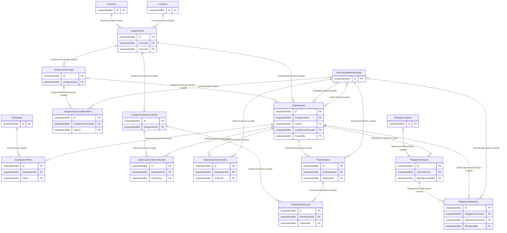

- **Submissions**: Exactly one of UserId (individual) or AssignmentGroupId (team) is set. Enforced by CHECK. Unique version per submitter via two filtered indexes.
- **SubmissionComments**: Inline instructor feedback anchored to a text range or file page via AnchorJson.
- **PlagiarismMatches**: Similarity is a signal; an instructor sets the outcome.

## Community & Live

```mermaid
erDiagram
    DiscussionThreads {
        uniqueidentifier Id PK
        uniqueidentifier CourseId FK
        uniqueidentifier LessonId FK
        uniqueidentifier AuthorId FK
    }
    DiscussionPosts {
        uniqueidentifier Id PK
        uniqueidentifier ThreadId FK
        uniqueidentifier AuthorId FK
        uniqueidentifier ParentPostId FK
    }
    DiscussionVotes {
        uniqueidentifier Id PK
        uniqueidentifier UserId FK
        uniqueidentifier ThreadId FK
        uniqueidentifier PostId FK
    }
    CourseReviews {
        uniqueidentifier Id PK
        uniqueidentifier UserId FK
        uniqueidentifier CourseId FK
    }
    CourseReviewReports {
        uniqueidentifier Id PK
        uniqueidentifier ReviewId FK
        uniqueidentifier UserId FK
    }
    ChatRooms {
        uniqueidentifier Id PK
        uniqueidentifier CourseId FK
    }
    ChatRoomMembers {
        uniqueidentifier Id PK
        uniqueidentifier ChatRoomId FK
        uniqueidentifier UserId FK
    }
    ChatMessages {
        uniqueidentifier Id PK
        uniqueidentifier ChatRoomId FK
        uniqueidentifier SenderId FK
    }
    Announcements {
        uniqueidentifier Id PK
        uniqueidentifier CourseId FK
        uniqueidentifier AuthorId FK
    }
    Notifications {
        uniqueidentifier Id PK
        uniqueidentifier UserId FK
    }
    PushTokens {
        uniqueidentifier Id PK
        uniqueidentifier UserId FK
        uniqueidentifier DeviceId FK
    }
    LiveSessions {
        uniqueidentifier Id PK
        uniqueidentifier CourseId FK
        uniqueidentifier HostId FK
    }
    LiveSessionAttendance {
        uniqueidentifier Id PK
        uniqueidentifier LiveSessionId FK
        uniqueidentifier UserId FK
    }
    Courses {
        uniqueidentifier Id PK
    }
    Lessons {
        uniqueidentifier Id PK
    }
    UserDevices {
        uniqueidentifier Id PK
    }
    UserTenantMemberships {
        uniqueidentifier Id PK
    }
    ChatRooms ||--o{ ChatMessages : "ChatRoomId (tenant-scoped)"
    ChatRooms ||--o{ ChatRoomMembers : "ChatRoomId (tenant-scoped)"
    CourseReviews ||--o{ CourseReviewReports : "ReviewId (tenant-scoped)"
    Courses |o--o{ Announcements : "CourseId (tenant-scoped)"
    Courses |o--o{ ChatRooms : "CourseId (tenant-scoped)"
    Courses ||--o{ CourseReviews : "CourseId (tenant-scoped)"
    Courses ||--o{ DiscussionThreads : "CourseId (tenant-scoped)"
    Courses ||--o{ LiveSessions : "CourseId (tenant-scoped)"
    DiscussionPosts |o--o{ DiscussionPosts : "ParentPostId (tenant-scoped)"
    DiscussionPosts |o--o{ DiscussionVotes : "PostId (tenant-scoped)"
    DiscussionThreads |o--o{ DiscussionVotes : "ThreadId (tenant-scoped)"
    DiscussionThreads ||--o{ DiscussionPosts : "ThreadId (tenant-scoped)"
    Lessons |o--o{ DiscussionThreads : "LessonId (tenant-scoped)"
    LiveSessions ||--o{ LiveSessionAttendance : "LiveSessionId (tenant-scoped)"
    UserDevices |o--o{ PushTokens : "DeviceId (tenant-scoped)"
    UserTenantMemberships ||--o{ Announcements : "AuthorId (tenant-scoped)"
    UserTenantMemberships ||--o{ ChatMessages : "SenderId (tenant-scoped)"
    UserTenantMemberships ||--o{ ChatRoomMembers : "UserId (tenant-scoped)"
    UserTenantMemberships ||--o{ CourseReviewReports : "UserId (tenant-scoped)"
    UserTenantMemberships ||--o{ CourseReviews : "UserId (tenant-scoped)"
    UserTenantMemberships ||--o{ DiscussionPosts : "AuthorId (tenant-scoped)"
    UserTenantMemberships ||--o{ DiscussionThreads : "AuthorId (tenant-scoped)"
    UserTenantMemberships ||--o{ DiscussionVotes : "UserId (tenant-scoped)"
    UserTenantMemberships ||--o{ LiveSessionAttendance : "UserId (tenant-scoped)"
    UserTenantMemberships ||--o{ LiveSessions : "HostId (tenant-scoped)"
    UserTenantMemberships ||--o{ Notifications : "UserId (tenant-scoped)"
    UserTenantMemberships ||--o{ PushTokens : "UserId (tenant-scoped)"
```

- **DiscussionVotes**: CHECK: exactly one of ThreadId / PostId. Unique per user and target.
- **CourseReviews**: One review per student per course; only enrolled students may post. CHECK: Rating between 1 and 5. Hidden = removed by moderation.
- **CourseReviewReports**: A user can report a review once; moderation resolves open reports.
- **LiveSessionAttendance**: JoinLink attendance means the student opened our join link, not that they stayed engaged.

## Gamification, Parents & Certificates

```mermaid
erDiagram
    XpTransactions {
        uniqueidentifier Id PK
        uniqueidentifier UserId FK
    }
    UserStreaks {
        uniqueidentifier Id PK
        uniqueidentifier UserId FK
    }
    Badges {
        uniqueidentifier Id PK
    }
    UserBadges {
        uniqueidentifier Id PK
        uniqueidentifier UserId FK
        uniqueidentifier BadgeId FK
    }
    ParentStudentLinks {
        uniqueidentifier Id PK
        uniqueidentifier ParentUserId FK
        uniqueidentifier StudentUserId FK
        uniqueidentifier ApprovedBy FK
    }
    ParentAlerts {
        uniqueidentifier Id PK
        uniqueidentifier ParentUserId FK
        uniqueidentifier StudentUserId FK
    }
    Certificates {
        uniqueidentifier Id PK
        uniqueidentifier UserId FK
        uniqueidentifier CourseId FK
        uniqueidentifier LearningPathId FK
        nvarchar VerificationCode UK
        uniqueidentifier PdfFileId FK
    }
    Courses {
        uniqueidentifier Id PK
    }
    FileAssets {
        uniqueidentifier Id PK
    }
    LearningPaths {
        uniqueidentifier Id PK
    }
    UserTenantMemberships {
        uniqueidentifier Id PK
    }
    Badges ||--o{ UserBadges : "BadgeId (tenant-scoped)"
    Courses |o--o{ Certificates : "CourseId (tenant-scoped)"
    FileAssets |o--o{ Certificates : "PdfFileId (tenant-scoped)"
    LearningPaths |o--o{ Certificates : "LearningPathId (tenant-scoped)"
    UserTenantMemberships |o--o{ ParentStudentLinks : "ApprovedBy (tenant-scoped)"
    UserTenantMemberships ||--o{ Certificates : "UserId (tenant-scoped)"
    UserTenantMemberships ||--o{ ParentAlerts : "ParentUserId (tenant-scoped)"
    UserTenantMemberships ||--o{ ParentAlerts : "StudentUserId (tenant-scoped)"
    UserTenantMemberships ||--o{ ParentStudentLinks : "ParentUserId (tenant-scoped)"
    UserTenantMemberships ||--o{ ParentStudentLinks : "StudentUserId (tenant-scoped)"
    UserTenantMemberships ||--o{ UserBadges : "UserId (tenant-scoped)"
    UserTenantMemberships ||--o{ UserStreaks : "UserId (tenant-scoped)"
    UserTenantMemberships ||--o{ XpTransactions : "UserId (tenant-scoped)"
```

- **XpTransactions**: Append-only. Leaderboards (course and global) are queries over this table, cached by the analytics job.
- **ParentStudentLinks**: A parent sees a student only while Status = Active. Approval by the student, an instructor or an admin is a tenant policy.
- **Certificates**: CHECK: exactly one of CourseId / LearningPathId. VerificationCode is globally unique for the public verify endpoint.

## Commerce: pricing and cart

```mermaid
erDiagram
    Bundles {
        uniqueidentifier Id PK
    }
    BundleCourses {
        uniqueidentifier Id PK
        uniqueidentifier BundleId FK
        uniqueidentifier CourseId FK
    }
    SubscriptionPlans {
        uniqueidentifier Id PK
    }
    SubscriptionPlanCourses {
        uniqueidentifier Id PK
        uniqueidentifier PlanId FK
        uniqueidentifier CourseId FK
    }
    UserSubscriptions {
        uniqueidentifier Id PK
        uniqueidentifier UserId FK
        uniqueidentifier PlanId FK
    }
    CartItems {
        uniqueidentifier Id PK
        uniqueidentifier UserId FK
        uniqueidentifier CourseId FK
        uniqueidentifier LessonId FK
        uniqueidentifier BundleId FK
        uniqueidentifier PlanId FK
        uniqueidentifier LearningPathId FK
    }
    Coupons {
        uniqueidentifier Id PK
        uniqueidentifier CourseId FK
    }
    Courses {
        uniqueidentifier Id PK
    }
    LearningPaths {
        uniqueidentifier Id PK
    }
    Lessons {
        uniqueidentifier Id PK
    }
    UserTenantMemberships {
        uniqueidentifier Id PK
    }
    Bundles |o--o{ CartItems : "BundleId (tenant-scoped)"
    Bundles ||--o{ BundleCourses : "BundleId (tenant-scoped)"
    Courses |o--o{ CartItems : "CourseId (tenant-scoped)"
    Courses |o--o{ Coupons : "CourseId (tenant-scoped)"
    Courses ||--o{ BundleCourses : "CourseId (tenant-scoped)"
    Courses ||--o{ SubscriptionPlanCourses : "CourseId (tenant-scoped)"
    LearningPaths |o--o{ CartItems : "LearningPathId (tenant-scoped)"
    Lessons |o--o{ CartItems : "LessonId (tenant-scoped)"
    SubscriptionPlans |o--o{ CartItems : "PlanId (tenant-scoped)"
    SubscriptionPlans ||--o{ SubscriptionPlanCourses : "PlanId (tenant-scoped)"
    SubscriptionPlans ||--o{ UserSubscriptions : "PlanId (tenant-scoped)"
    UserTenantMemberships ||--o{ CartItems : "UserId (tenant-scoped)"
    UserTenantMemberships ||--o{ UserSubscriptions : "UserId (tenant-scoped)"
```

- **CartItems**: CHECK: exactly one target column matches ItemType.

## Commerce: vouchers, wallet and affiliates

```mermaid
erDiagram
    WishlistItems {
        uniqueidentifier Id PK
        uniqueidentifier UserId FK
        uniqueidentifier CourseId FK
    }
    VoucherBatches {
        uniqueidentifier Id PK
        uniqueidentifier CourseId FK
        uniqueidentifier BackgroundJobId FK
        uniqueidentifier ExportFileId FK
    }
    Vouchers {
        uniqueidentifier Id PK
        uniqueidentifier VoucherBatchId FK
        uniqueidentifier RedeemedBy FK
    }
    Wallets {
        uniqueidentifier Id PK
        uniqueidentifier UserId FK
    }
    WalletTransactions {
        uniqueidentifier Id PK
        uniqueidentifier WalletId FK
        uniqueidentifier CreatedBy FK
    }
    AffiliateProfiles {
        uniqueidentifier Id PK
        uniqueidentifier UserId FK
    }
    Referrals {
        uniqueidentifier Id PK
        uniqueidentifier AffiliateUserId FK
        uniqueidentifier ReferredUserId FK
    }
    AffiliateCommissions {
        uniqueidentifier Id PK
        uniqueidentifier AffiliateUserId FK
        uniqueidentifier OrderId FK
        uniqueidentifier WalletTransactionId FK
    }
    InstructorRevenueShares {
        uniqueidentifier Id PK
        uniqueidentifier CourseId FK
        uniqueidentifier InstructorId FK
    }
    CourseLearningWeights {
        uniqueidentifier Id PK
        uniqueidentifier CourseId FK
    }
    OrderItemAllocations {
        uniqueidentifier Id PK
        uniqueidentifier OrderItemId FK
        uniqueidentifier CourseId FK
    }
    OrderItemShares {
        uniqueidentifier Id PK
        uniqueidentifier OrderItemId FK
        uniqueidentifier CourseId FK
        uniqueidentifier InstructorId FK
        uniqueidentifier SettledPayoutId FK
    }
    InstructorPayouts {
        uniqueidentifier Id PK
        uniqueidentifier InstructorId FK
        uniqueidentifier ApprovedBy FK
    }
    InstructorPayoutLines {
        uniqueidentifier Id PK
        uniqueidentifier InstructorPayoutId FK
        uniqueidentifier OrderId FK
        uniqueidentifier OrderItemId FK
        uniqueidentifier CourseId FK
    }
    OrderRefunds {
        uniqueidentifier Id PK
        uniqueidentifier OrderId FK
        uniqueidentifier RecordedBy FK
    }
    InstructorDebits {
        uniqueidentifier Id PK
        uniqueidentifier InstructorId FK
        uniqueidentifier OrderRefundId FK
        uniqueidentifier SourcePayoutId FK
    }
    InstructorDebitApplications {
        uniqueidentifier Id PK
        uniqueidentifier InstructorDebitId FK
        uniqueidentifier InstructorPayoutId FK
    }
    BackgroundJobs {
        uniqueidentifier Id PK
    }
    Courses {
        uniqueidentifier Id PK
    }
    FileAssets {
        uniqueidentifier Id PK
    }
    OrderItems {
        uniqueidentifier Id PK
    }
    Orders {
        uniqueidentifier Id PK
    }
    UserTenantMemberships {
        uniqueidentifier Id PK
    }
    BackgroundJobs |o--o{ VoucherBatches : "BackgroundJobId (tenant-scoped)"
    Courses |o--o{ VoucherBatches : "CourseId (tenant-scoped)"
    Courses ||--o{ CourseLearningWeights : "CourseId (tenant-scoped)"
    Courses ||--o{ InstructorPayoutLines : "CourseId (tenant-scoped)"
    Courses ||--o{ InstructorRevenueShares : "CourseId (tenant-scoped)"
    Courses ||--o{ OrderItemAllocations : "CourseId (tenant-scoped)"
    Courses ||--o{ OrderItemShares : "CourseId (tenant-scoped)"
    Courses ||--o{ WishlistItems : "CourseId (tenant-scoped)"
    FileAssets |o--o{ VoucherBatches : "ExportFileId (tenant-scoped)"
    InstructorDebits ||--o{ InstructorDebitApplications : "InstructorDebitId (tenant-scoped)"
    InstructorPayouts |o--o{ OrderItemShares : "SettledPayoutId (tenant-scoped)"
    InstructorPayouts ||--o{ InstructorDebitApplications : "InstructorPayoutId (tenant-scoped)"
    InstructorPayouts ||--o{ InstructorDebits : "SourcePayoutId (tenant-scoped)"
    InstructorPayouts ||--o{ InstructorPayoutLines : "InstructorPayoutId (tenant-scoped)"
    OrderItems ||--o{ InstructorPayoutLines : "OrderItemId (tenant-scoped)"
    OrderItems ||--o{ OrderItemAllocations : "OrderItemId (tenant-scoped)"
    OrderItems ||--o{ OrderItemShares : "OrderItemId (tenant-scoped)"
    OrderRefunds ||--o{ InstructorDebits : "OrderRefundId (tenant-scoped)"
    Orders ||--o{ AffiliateCommissions : "OrderId (tenant-scoped)"
    Orders ||--o{ InstructorPayoutLines : "OrderId (tenant-scoped)"
    Orders ||--o{ OrderRefunds : "OrderId (tenant-scoped)"
    UserTenantMemberships |o--o{ InstructorPayouts : "ApprovedBy (tenant-scoped)"
    UserTenantMemberships |o--o{ OrderRefunds : "RecordedBy (tenant-scoped)"
    UserTenantMemberships |o--o{ Vouchers : "RedeemedBy (tenant-scoped)"
    UserTenantMemberships |o--o{ WalletTransactions : "CreatedBy (tenant-scoped)"
    UserTenantMemberships ||--o{ AffiliateCommissions : "AffiliateUserId (tenant-scoped)"
    UserTenantMemberships ||--o{ AffiliateProfiles : "UserId (tenant-scoped)"
    UserTenantMemberships ||--o{ InstructorDebits : "InstructorId (tenant-scoped)"
    UserTenantMemberships ||--o{ InstructorPayouts : "InstructorId (tenant-scoped)"
    UserTenantMemberships ||--o{ InstructorRevenueShares : "InstructorId (tenant-scoped)"
    UserTenantMemberships ||--o{ OrderItemShares : "InstructorId (tenant-scoped)"
    UserTenantMemberships ||--o{ Referrals : "AffiliateUserId (tenant-scoped)"
    UserTenantMemberships ||--o{ Referrals : "ReferredUserId (tenant-scoped)"
    UserTenantMemberships ||--o{ Wallets : "UserId (tenant-scoped)"
    UserTenantMemberships ||--o{ WishlistItems : "UserId (tenant-scoped)"
    VoucherBatches ||--o{ Vouchers : "VoucherBatchId (tenant-scoped)"
    WalletTransactions |o--o{ AffiliateCommissions : "WalletTransactionId (tenant-scoped)"
    Wallets ||--o{ WalletTransactions : "WalletId (tenant-scoped)"
```

- **WishlistItems**: Student wishlist: courses saved for later, one row per student-course pair.
- **Vouchers**: Only the SHA-256 of the code is stored. Plain codes exist once, in the CSV produced when the batch is generated.
- **WalletTransactions**: Append-only ledger. Amount is signed. Balance changes only through this table, inside a transaction with the wallet row's RowVersion check.
- **CourseLearningWeights**: TenantAdmin-approved learning time of ALL non-video content of a course together (split over its non-video lessons), used only for subscription revenue allocation.
- **OrderItemAllocations**: Snapshot taken at checkout for each course covered by the line: its list price (bundle and path weights) and, for subscription plans, the approved non-video learning time and the published non-video lesson count at purchase.
- **OrderItemShares**: Snapshot taken at checkout: which instructors earn from each covered course and at what percentage. A null percentage means none was configured at purchase and the current setting is used when earnings are calculated.
- **InstructorPayouts**: Payout is recorded here; actual money transfer is outside the system.
- **InstructorPayoutLines**: Immutable record of what each payout earned per order line and course: GrossEarned before refunds, PaidEarned after refunds that existed at calculation. Refund debits are computed from these rows, never from recomputed activity.
- **OrderRefunds**: Accounting record of a refund decided and executed outside the system. It moves no money; it only reverses instructor earnings proportionally.
- **InstructorDebits**: Earnings already inside a calculated payout when their sale was refunded. Carried against the instructor's next payouts; never withdrawn automatically.
- **InstructorDebitApplications**: How much of a debit a payout absorbed. Cancelling the payout gives the amount back to the debit.

## Commerce: orders and payments

```mermaid
erDiagram
    Orders {
        uniqueidentifier Id PK
        uniqueidentifier UserId FK
        uniqueidentifier CouponId FK
    }
    OrderItems {
        uniqueidentifier Id PK
        uniqueidentifier OrderId FK
        uniqueidentifier CourseId FK
        uniqueidentifier LessonId FK
        uniqueidentifier BundleId FK
        uniqueidentifier PlanId FK
        uniqueidentifier LearningPathId FK
    }
    CouponRedemptions {
        uniqueidentifier Id PK
        uniqueidentifier CouponId FK
        uniqueidentifier UserId FK
        uniqueidentifier OrderId FK
    }
    Payments {
        uniqueidentifier Id PK
        uniqueidentifier OrderId FK
        nvarchar IdempotencyKey UK
    }
    ManualPaymentSubmissions {
        uniqueidentifier Id PK
        uniqueidentifier UserId FK
        uniqueidentifier OrderId FK
        uniqueidentifier ReceiptFileId FK
        uniqueidentifier ReviewedBy FK
        uniqueidentifier WalletTransactionId FK
    }
    Invoices {
        uniqueidentifier Id PK
        uniqueidentifier OrderId FK
        uniqueidentifier PdfFileId FK
    }
    Bundles {
        uniqueidentifier Id PK
    }
    Coupons {
        uniqueidentifier Id PK
    }
    Courses {
        uniqueidentifier Id PK
    }
    FileAssets {
        uniqueidentifier Id PK
    }
    LearningPaths {
        uniqueidentifier Id PK
    }
    Lessons {
        uniqueidentifier Id PK
    }
    SubscriptionPlans {
        uniqueidentifier Id PK
    }
    UserTenantMemberships {
        uniqueidentifier Id PK
    }
    WalletTransactions {
        uniqueidentifier Id PK
    }
    Bundles |o--o{ OrderItems : "BundleId (tenant-scoped)"
    Coupons |o--o{ Orders : "CouponId (tenant-scoped)"
    Coupons ||--o{ CouponRedemptions : "CouponId (tenant-scoped)"
    Courses |o--o{ OrderItems : "CourseId (tenant-scoped)"
    FileAssets |o--o{ Invoices : "PdfFileId (tenant-scoped)"
    FileAssets ||--o{ ManualPaymentSubmissions : "ReceiptFileId (tenant-scoped)"
    LearningPaths |o--o{ OrderItems : "LearningPathId (tenant-scoped)"
    Lessons |o--o{ OrderItems : "LessonId (tenant-scoped)"
    Orders |o--o{ ManualPaymentSubmissions : "OrderId (tenant-scoped)"
    Orders ||--o{ CouponRedemptions : "OrderId (tenant-scoped)"
    Orders ||--o{ Invoices : "OrderId (tenant-scoped)"
    Orders ||--o{ OrderItems : "OrderId (tenant-scoped)"
    Orders ||--o{ Payments : "OrderId (tenant-scoped)"
    SubscriptionPlans |o--o{ OrderItems : "PlanId (tenant-scoped)"
    UserTenantMemberships |o--o{ ManualPaymentSubmissions : "ReviewedBy (tenant-scoped)"
    UserTenantMemberships ||--o{ CouponRedemptions : "UserId (tenant-scoped)"
    UserTenantMemberships ||--o{ ManualPaymentSubmissions : "UserId (tenant-scoped)"
    UserTenantMemberships ||--o{ Orders : "UserId (tenant-scoped)"
    WalletTransactions |o--o{ ManualPaymentSubmissions : "WalletTransactionId (tenant-scoped)"
```

- **Payments**: Raw gateway payloads are not stored (they can carry card data). Store only reference and status.
- **ManualPaymentSubmissions**: Admin review queue. Approval writes the order/wallet change and an audit row in one transaction.

## Enterprise & Analytics

```mermaid
erDiagram
    AuditLogs {
        uniqueidentifier Id PK
        uniqueidentifier UserId FK
    }
    ApiKeys {
        uniqueidentifier Id PK
        nvarchar KeyHash UK
    }
    WebhookEndpoints {
        uniqueidentifier Id PK
    }
    WebhookDeliveries {
        uniqueidentifier Id PK
        uniqueidentifier WebhookEndpointId FK
        uniqueidentifier BackgroundJobId FK
    }
    LessonIndexStates {
        uniqueidentifier Id PK
        uniqueidentifier LessonId FK
    }
    LessonTranscripts {
        uniqueidentifier Id PK
        uniqueidentifier LessonId FK
    }
    AiUsageLogs {
        uniqueidentifier Id PK
        uniqueidentifier UserId FK
        uniqueidentifier CourseId FK
    }
    DropoutRiskScores {
        uniqueidentifier Id PK
        uniqueidentifier UserId FK
        uniqueidentifier CourseId FK
    }
    AnalyticsSnapshots {
        uniqueidentifier Id PK
        uniqueidentifier CourseId FK
    }
    AspNetUsers {
        uniqueidentifier Id PK
    }
    BackgroundJobs {
        uniqueidentifier Id PK
    }
    Courses {
        uniqueidentifier Id PK
    }
    Lessons {
        uniqueidentifier Id PK
    }
    UserTenantMemberships {
        uniqueidentifier Id PK
    }
    AspNetUsers |o--o{ AuditLogs : "UserId"
    BackgroundJobs |o--o{ WebhookDeliveries : "BackgroundJobId (tenant-scoped)"
    Courses |o--o{ AiUsageLogs : "CourseId (tenant-scoped)"
    Courses |o--o{ AnalyticsSnapshots : "CourseId (tenant-scoped)"
    Courses ||--o{ DropoutRiskScores : "CourseId (tenant-scoped)"
    Lessons ||--o{ LessonIndexStates : "LessonId (tenant-scoped)"
    Lessons ||--o{ LessonTranscripts : "LessonId (tenant-scoped)"
    UserTenantMemberships |o--o{ AiUsageLogs : "UserId (tenant-scoped)"
    UserTenantMemberships ||--o{ DropoutRiskScores : "UserId (tenant-scoped)"
    WebhookEndpoints ||--o{ WebhookDeliveries : "WebhookEndpointId (tenant-scoped)"
```

- **AuditLogs**: Append-only. Application DB user should have INSERT/SELECT only. Sensitive values (passwords, tokens) are never written.
- **ApiKeys**: Full key shown once at creation; only the hash is stored.
- **WebhookEndpoints**: SecretProtected uses ASP.NET Data Protection. Deliveries are signed with HMAC-SHA256.
- **LessonIndexStates**: Tracks what the AI service has embedded so ingest runs only when content changed.
- **LessonTranscripts**: Timed Whisper cues for player captions and transcript seek. Written by the AI ingest job for video/audio lessons; replaced on re-ingest.
- **AiUsageLogs**: No prompt text stored. Used for rate limiting and cost review.
- **AnalyticsSnapshots**: Pre-computed dashboards, drop-off heatmaps, leaderboards and revenue rollups written by Hangfire jobs.

